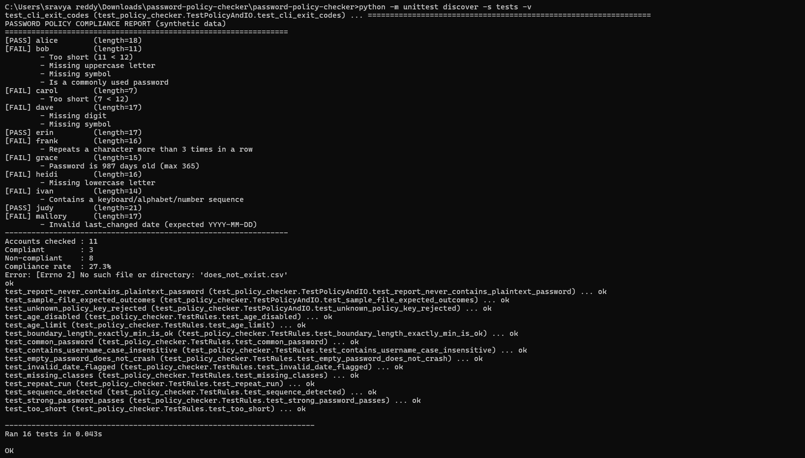
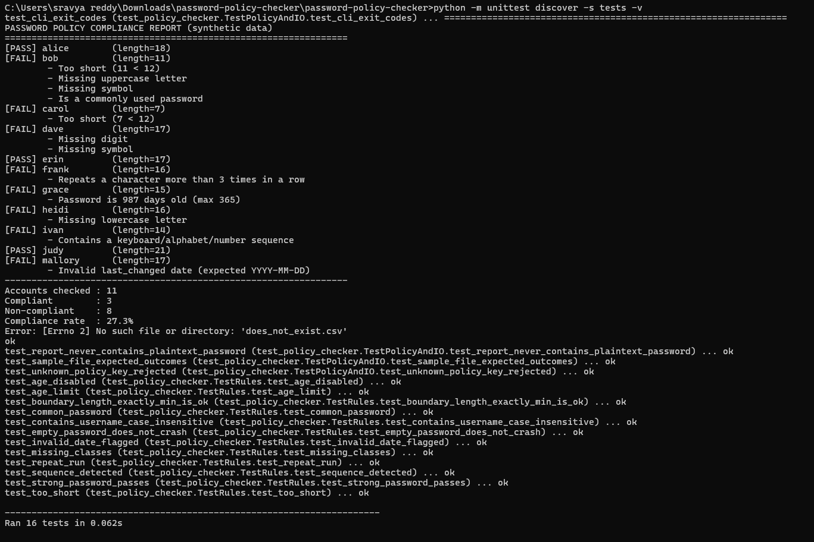

# Password Policy Compliance Checker


**Task 13 – Build a Small Defensive Security Tool**

A small Python tool that audits **synthetic** account records against a configurable
password policy and reports exactly which rules each account violates.
Standard library only, no installation needed (Python 3.9+).

## Why this tool
Weak, reused, or stale passwords remain a leading cause of account compromise.
Auditing policy compliance is a routine defensive task (e.g. before enforcing a new
policy, or in a lab/CI check on test fixtures). The tool is deliberately benign: it
only reads a CSV of made-up credentials and never contacts any system.

## Usage
```bash
python policy_checker.py data/synthetic_accounts.csv
python policy_checker.py data/synthetic_accounts.csv --policy example_policy.json \
    --json output/report.json --csv output/report.csv --today 2026-10-28
python -m unittest discover -s tests -v      # run test cases
```
Input CSV columns: `username,password,last_changed` (YYYY-MM-DD). UTF-8 files with a BOM
(as saved by Excel) are accepted.
Exit codes: `0` all compliant, `1` violations found, `2` input/config error
(unreadable file, malformed CSV row, bad policy file, invalid `--today`).

## Rules checked (all configurable via JSON)
| Rule | Default |
|---|---|
| Minimum length | 12 |
| Uppercase / lowercase / digit / symbol required | all on |
| Must not contain the username (usernames shorter than `username_min_len`, default 3, are skipped) | on |
| Not in common-password denylist (also catches case, leetspeak and trailing digits/symbols, e.g. `P@ssw0rd!!`) | on |
| No alphabet/number/keyboard sequences (4+ chars, asc/desc) | on |
| No character repeated more than N times in a row (0 = off) | 3 |
| Maximum password age (days, 0 = off) | 365 |
| `last_changed` must be present, valid and not in the future | always |

Spaces count as symbols (so passphrases are not penalised) and only ASCII digits count as digits.

Example: see `example_policy.json` (`python policy_checker.py data/synthetic_accounts.csv --policy example_policy.json`).
Unknown keys and wrongly-typed values (e.g. `"min_length": "12"`) are rejected so a typo
cannot silently weaken the policy.

## Design decisions
- **Passwords never appear in output** – reports show only length, age and violations.
- **Fail-safe config** – unknown policy keys or wrong value types raise an error (exit code 2).
- **Safe CSV output** – cells beginning with `=`, `+`, `-` or `@` are prefixed with `'` so spreadsheets do not evaluate them as formulas.
- **CI-friendly** – meaningful exit codes; `--today` makes output reproducible.
- **Local-only** – the denylist is embedded; no network calls.

## Test cases (`tests/test_policy_checker.py`, 33 tests)
Each rule individually, the exact length boundary (12 chars), case-insensitive
username matching, ascending/descending sequences, repeat-run counting, age limit
on/off, invalid dates, empty password (no crash), unknown policy key, a check that
plaintext passwords never leak into reports, expected pass/fail per account in the
sample file, and CLI exit codes.

A second group of regression tests covers issues found in code review: invalid `--today`,
blank/missing/future `last_changed`, wrongly-typed or non-object policy files, short CSV rows,
UTF-8 BOM files, `max_repeat_run: 0`, common-password variants, short usernames, Unicode
digits, spaces as symbols, and CSV formula injection.

## Debugging note
While writing the tests, the sample-file test failed for user `erin`. Investigation
showed the tool was correct: my synthetic password contained the username
("erin#Secure…"). I fixed the test data, not the tool – a useful reminder that tests
verify the data as well as the code.

## Limitations (honest scope)
- The denylist is tiny and illustrative (variant matching helps, but a real deployment should
  use a large breached-password list, e.g. Have I Been Pwned's offline data).
- Rule-based checks cannot measure true strength (e.g. `Blue-Giraffe-Lamp-47!` passes
  but a leaked passphrase would still be weak). Length and uniqueness matter more than complexity.
- Max-age rotation is included because many organisations still require it, but
  NIST SP 800-63B recommends *against* forced periodic rotation without evidence of
  compromise; set `max_age_days` to 0 to follow that guidance.
- Real systems store salted hashes, not plaintext; this tool is for synthetic/lab data only.

## Project structure
```
policy_checker.py          main tool (CLI + importable functions)
example_policy.json        sample policy override
data/synthetic_accounts.csv  made-up test accounts
tests/                     unit tests (unittest)
output/                    sample reports from a real run
.github/workflows/         CI: runs tests on push
```
## Screenshots

### Test Results


### Tool Execution


## Disclaimer
All credentials in this repository are fabricated for testing. Do not use this tool
on real passwords; audit hashed credentials with approved enterprise tooling instead.
